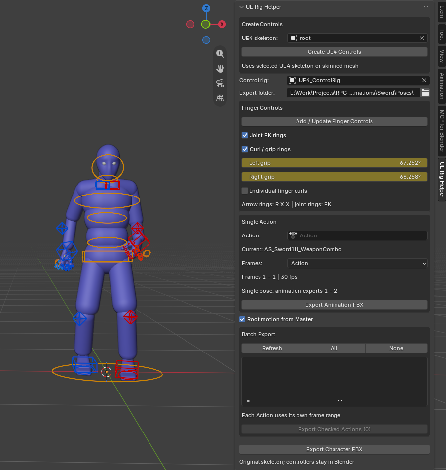

# UE Rig Helper — 1.3.0

Blender add-on for creating control rigs on existing UE4 skeletons and exporting animations to Unreal Engine.
Requires Blender 4.4 or later. Tested in Blender 5.2.2 LTS.

## Files

ue_rig_helper.py — complete add-on source; no external Python packages required.
README.txt — installation and usage instructions.

## Install

1. If UE4 Control Rig Export / UE4 Control Rig Tools is installed, disable it first.
   The renamed add-on uses the same internal operators and saved scene settings.
   Do not enable both versions at the same time.
2. In Blender, open Edit > Preferences > Add-ons > Install from Disk.
3. Select ue_rig_helper.py and enable UE Rig Helper.
4. In the 3D Viewport, press N and open the UE Rig Helper tab.

## Create controls

Import a character with a standard UE4 skeleton, without animation, in its rest pose.
Select the armature, its skinned mesh, or the imported objects of one character.
Click Create UE4 Controls. You can also choose the armature in UE4 skeleton.

The add-on creates a separate control rig and enters Pose Mode:

- G: move IK hand/foot controls, elbow/knee poles, pelvis and master.
- R: rotate hands, feet and body controls.
- Finger joint rings are visible by default. Rotate them for detailed FK poses.

Original bones, hierarchy, rest matrices and skin weights are preserved.
The source armature is hidden and protected from selection.
Repeated clicks reuse existing controls. Creation supports Undo.
The source must be local, without existing constraints or active animation,
with standard UE4 bone names and a positive uniform object scale.

## Export

Single Action: choose an Action and click Export Animation FBX.
Clearing the Action field uses the control rig's active Action.
Frames > Action uses that clip's range; Timeline uses the scene range.

Batch Export: Refresh, check the required Actions, then Export Checked Actions.
Each Action gets a separate FBX in Export folder, using its own frame range.
All / None selects or clears the checkboxes.

Root motion from Master routes the master control's movement into the exported root.
Export Character FBX writes the mesh and original skeleton in their reference pose.
Controllers and shape objects stay in Blender; animation is baked every frame.
A single-key pose is exported as two identical frames to avoid zero-length clips.
Existing FBX files are backed up as .fbx.bak before being replaced.
The active Action, slot, pose, frame, visibility and selection are restored after export.

## Validation

Control creation, duplicate prevention, failed-build cleanup, straight limbs,
single/batch export and FBX roundtrip checks were tested in Blender.
The user verified successful import of the original export pipeline in Unreal.

## Development

The source is a single Python file. Internal ue4.\* operator identifiers and
scene.ue4_export_settings are retained for compatibility with existing .blend files.

## Finger controls — 1.3.0

New rigs include 30 visible FK joint rings, 10 individual finger curl controls,
and 2 larger grip controls (one per hand).
For a rig created with an older version, click Add / Update Finger Controls.
Repeated clicks show the existing controls without adding duplicates.

Small joint rings: rotate normally for detailed FK poses.
Arrow rings: R, X, X rotates around the control's local bend axis.
Positive angles curl fingers inward on both hands.
Large yellow rings: grip all fingers of the corresponding hand.
Alt+R resets a selected curl or grip control.

The Finger Controls panel has Left grip / Right grip angle fields.
Enable Individual finger curls to show angle fields for each finger.
These fields and control rotations can be keyframed normally.
Fingers FK and Fingers Curl checkboxes show or hide the two sets of controls.

Curl and grip are additive to existing FK animation. Original FK bone names
and animation paths are retained, as are the original UE4 bones and skin weights.
Single and batch FBX export bake the finger drivers onto the original skeleton.
